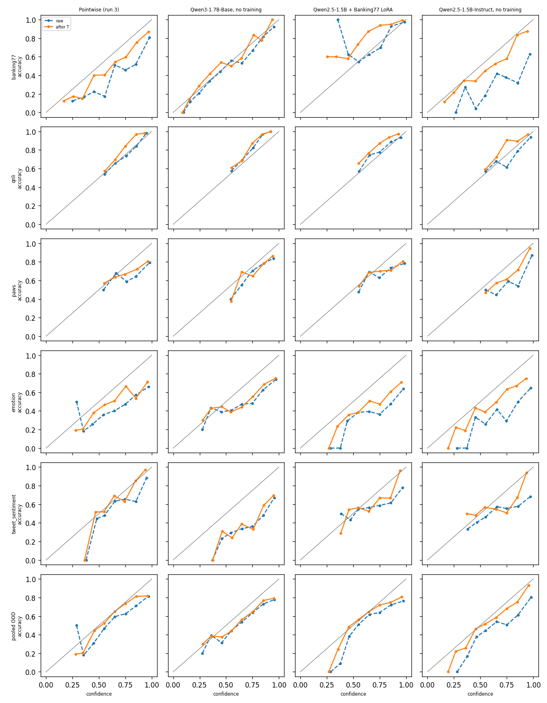
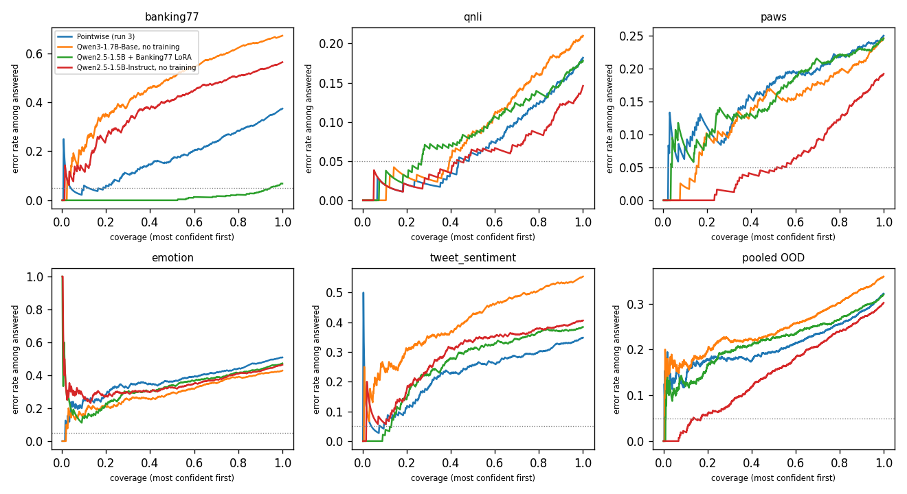

# Pointwise Phase 5 results

## Findings

Comparisons are on 500 held-out questions per source (pooled out-of-domain, "OOD" = 2,000). A gap is called distinguishable from noise only when its paired-bootstrap 95% interval excludes 0. 36 per-source and pooled intervals were computed without any multiple-comparison correction, so a result whose interval barely excludes 0 (marked "borderline") should be read as weak. Calibration differences (ECE) have no interval in this report, so they are point estimates only.

### Where Pointwise wins
- **Against its own no-training base (Qwen3-1.7B-Base):** pooled OOD accuracy 0.678 vs 0.640, gap +3.8 points, CI [+1.8, +5.8], distinguishable from noise. Banking77 (zero-shot for Pointwise) +29.8 [+25.2, +34.6] and TweetEval +20.6 [+15.0, +26.0] are large; QNLI (+2.8) and PAWS (-0.4) are noise.
- **Pooled OOD calibration after T (mixed, point estimates only):** 0.056 vs 0.109 for the Qwen3 base and 0.081 for the LoRA specialist, but Qwen2.5-Instruct is 0.052. Raw pooled ECE barely differs (0.129 vs 0.134 and 0.146). Pooling hides per-source errors that cancel: Pointwise's after-T ECE is worse than the Qwen3 base on Banking77 (0.113 vs 0.046) and PAWS (0.130 vs 0.080), and worse than Instruct on QNLI, PAWS and Emotion. The clear per-source gain is TweetEval (0.038 vs 0.288 for the Qwen3 base).
- **Option-order flip rate:** Pointwise 0.210 / 0.075 / 0.045 on Banking77 / Emotion / TweetEval, against 0.615 / 0.190 / 0.070 for the Qwen3 base. The no-training baseline is far more sensitive to option order on Banking77.
- **Latency on a T4 (one ~512-token state, k questions):** one pass costs 196 ms for k=1 and 261 ms for k=8. Generate-and-parse with the Qwen3 base costs 223 ms and 1,890 ms, about 7x slower at k=8. At k=1 they are close (196 vs 223 ms).
- **Against the no-training Qwen2.5-1.5B-Instruct on Banking77 and TweetEval:** +19.0 [+14.0, +24.2] and +5.8 [+0.8, +10.6] (TweetEval borderline).

### Where Pointwise loses
- **Emotion, against its own no-training base:** -8.0 points, CI [-11.8, -4.2]. The untrained Qwen3 base is more accurate here. This loss is not hidden.
- **Against the no-training Qwen2.5-1.5B-Instruct (a different base model):** pooled OOD -2.0 [-4.0, -0.1] (borderline), PAWS -5.8 [-9.6, -2.0], Emotion -4.4 [-8.0, -1.0]. QNLI -3.6 [-7.2, 0.0] is not distinguishable.
- **Selective prediction:** Cov@5% (share of questions answerable at <=5% error) on pooled OOD is 0.004 for Pointwise, essentially nothing, against 0.171 for Qwen2.5-Instruct. Pointwise's after-T ECE (0.056) is about the same as Qwen2.5-Instruct's (0.052), but Instruct ranks its confident answers much better (AURC 0.148 vs 0.209). Cov@5% is near zero for three of four arms on pooled OOD (Pointwise 0.004, Qwen3 base 0.004, LoRA 0.011; about 8 of 2,000 questions), so only Instruct stands out; Pointwise's AURC beats the Qwen3 base's (0.209 vs 0.246).
- **The Phase 4 gate (pooled OOD ECE after T <= 0.05) was missed (0.056) and is still missed.** This report has no numeric gate.
- **Banking77 against the specialist:** the Banking77 LoRA gets 0.932 against Pointwise's 0.626, gap -30.6 [-34.8, -26.0]. That is expected: Banking77 is in-domain for the LoRA and zero-shot for Pointwise.

### Not distinguishable from noise
- Pointwise vs the Banking77 LoRA on pooled OOD: -0.2 [-2.1, +1.7]; per-source QNLI, PAWS, Emotion and TweetEval all include 0 (Emotion -3.6 [-7.2, 0.0] only just).
- Pointwise vs Qwen3 base on QNLI and PAWS.

### Fine-tune vs its own base
- Pointwise vs Qwen3-1.7B-Base: win on pooled OOD (above).
- Banking77 LoRA vs Qwen2.5-1.5B-Instruct: Banking77 +49.6 [+44.8, +54.4], but pooled OOD -1.8 [-3.4, -0.2] (borderline): the specialist lost accuracy on QNLI (-3.2 [-5.8, -0.4]) and PAWS (-5.4 [-9.2, -1.8]), both distinguishable from noise, offset in the pool by Emotion and TweetEval.

### Caveats
- **Flip rate for the Qwen2.5 arms on Banking77 (0.000) is not comparable.** That path scores the fixed label names from the message alone and never shows the option list, so reordering options cannot change it. It says nothing about robustness.
- **Pointwise and the Qwen2.5 arms use different base models,** so those gaps mix "method" with "base model". The own-base comparisons are the cleaner ones.
- **Latency:** Pointwise ran with the LoRA unmerged. Generate-and-parse is capped at 8 new tokens and the base model may not stop early. One state of about 512 tokens, median of 5 runs, one T4.
- **Reproduction check passed:** Pointwise logits match Phase 4 run 3's saved held-out predictions (largest difference 0.0000, same top option on all 2,500 questions, T 1.516, pooled OOD ECE 0.0561). The LoRA arm's Banking77 accuracy is 0.932, near the Phase 0 read-out's 0.918, so the scoring path is sound.
- **Kev-0.8B / Kev-4B were not run.** Kev's model card lists Banking77 among its training sets, so Banking77 would be in-domain for Kev, and it needs a separate Qwen3.5 Gated-DeltaNet environment that was not set up. QNLI, PAWS and Emotion would have been fair comparisons.
- Rerun note: this findings text is hand-written for the version-17 numbers; regenerate it if the arms change.
- Dev questions of type score (policies, SST-5, Yelp) are answered only by Pointwise, so the baselines' T is fitted on 1,844 of Pointwise's 2,230 dev questions.

## Protocol

All arms score the same 2,500 held-out questions (500 per source) that Phase 4 run 3 used. Temperature T is fitted per arm on that arm's own dev rows (dev questions answered per arm: Pointwise (run 3) 2,230, Qwen3-1.7B-Base, no training 1,844, Qwen2.5-1.5B + Banking77 LoRA 1,844, Qwen2.5-1.5B-Instruct, no training 1,844; the baselines skip the score-type dev questions (policies, SST-5, Yelp) that Pointwise answers, and Pointwise keeps its full dev set so its T is run 3's), never on held-out. Banking77 is zero-shot for Pointwise and Qwen3; it is in-domain for the Banking77 LoRA arm (and would be for a Kev arm). Sanity check: the LoRA arm's Banking77 accuracy should be near the Phase 0 read-out's 0.918; if it is far lower, the scoring path is wrong and nothing below should be trusted.

## How to read this

- **Accuracy** counts a question right when the highest-probability option is the gold one.
- **Calibration** asks whether confidence matches accuracy: of questions answered with ~80% confidence, ~80% should be right. **ECE** is the average gap, weighted by how many questions fall in each confidence bin (0 is perfect).
- **Temperature T** divides every logit by one number fitted on dev. It softens or sharpens confidence without ever changing which option wins, so accuracy is untouched.
- **Reliability diagram:** one point per confidence bin, accuracy against confidence. On the diagonal is calibrated; below it is over-confident.
- **Risk-coverage curve:** answer only the most confident questions first. Coverage is the share answered and risk is the error rate among them. **Cov@5%** is the largest coverage whose error rate stays within 5%. **AURC** is the area under the curve (lower is better).
- **Paired bootstrap:** the same held-out questions are resampled with replacement 2,000 times and the accuracy gap recomputed each time. If the 95% interval excludes 0, the gap is unlikely to be sampling noise. 500 questions per source is small, so intervals are wide and a gap of a few points will often read 'unclear'.

## Accuracy and calibration per source (accuracy / raw ECE / ECE after T)

| Arm | T | banking77 | qnli | paws | emotion | tweet_sentiment | pooled OOD acc | pooled OOD ECE raw | pooled OOD ECE after T |
|---|---|---|---|---|---|---|---|---|---|
| Pointwise (run 3) | 1.52 | 0.626 / 0.209 / 0.113 | 0.818 / 0.019 / 0.082 | 0.750 / 0.176 / 0.130 | 0.492 / 0.258 / 0.159 | 0.652 / 0.092 / 0.038 | 0.678 | 0.129 | 0.056 |
| Qwen3-1.7B-Base, no training | 1.14 | 0.328 / 0.052 / 0.046 | 0.790 / 0.067 / 0.088 | 0.754 / 0.096 / 0.080 | 0.572 / 0.193 / 0.169 | 0.446 / 0.317 / 0.288 | 0.640 | 0.134 | 0.109 |
| Qwen2.5-1.5B + Banking77 LoRA | 1.67 | 0.932 / 0.023 / 0.084 | 0.822 / 0.032 / 0.107 | 0.754 / 0.184 / 0.136 | 0.528 / 0.313 / 0.207 | 0.616 / 0.131 / 0.089 | 0.680 | 0.146 | 0.081 |
| Qwen2.5-1.5B-Instruct, no training | 2.15 | 0.436 / 0.350 / 0.078 | 0.854 / 0.062 / 0.068 | 0.808 / 0.137 / 0.065 | 0.536 / 0.326 / 0.138 | 0.594 / 0.212 / 0.091 | 0.698 | 0.178 | 0.052 |

## Selective prediction after T: Cov@5% / AURC

| Arm | banking77 | qnli | paws | emotion | tweet_sentiment | pooled OOD |
|---|---|---|---|---|---|---|
| Pointwise (run 3) | 0.186 / 0.179 | 0.482 / 0.068 | 0.022 / 0.162 | 0.014 / 0.361 | 0.096 / 0.224 | 0.004 / 0.209 |
| Qwen3-1.7B-Base, no training | 0.022 / 0.469 | 0.392 / 0.090 | 0.160 / 0.137 | 0.018 / 0.292 | 0.006 / 0.399 | 0.004 / 0.246 |
| Qwen2.5-1.5B + Banking77 LoRA | 0.944 / 0.012 | 0.266 / 0.087 | 0.040 / 0.156 | 0.000 / 0.330 | 0.130 / 0.259 | 0.011 / 0.216 |
| Qwen2.5-1.5B-Instruct, no training | 0.012 / 0.380 | 0.458 / 0.057 | 0.538 / 0.063 | 0.000 / 0.347 | 0.016 / 0.286 | 0.171 / 0.148 |

## Reproduction check: Pointwise against Phase 4 run 3

- Largest difference in any held-out logit: 0.0000; same top option on 100.0% of 2500 questions.
- T refitted here on the rebuilt dev rows: 1.516.
- Run 3's saved T: 1.516. Pooled OOD ECE with this run's logits and that T: 0.0561 (run 3 logged 0.0561).
- If these differ a lot, the weights or the question sample are not run 3's and every arm's dev-fitted T is suspect.

## Accuracy gaps with paired bootstrap 95% intervals (percentage points, 2,000 resamples)

### Pointwise (run 3) minus Qwen3-1.7B-Base, no training

| Source | n | gap | 95% CI | reading |
|---|---|---|---|---|
| banking77 | 500 | +29.8 | [+25.2, +34.6] | Pointwise (run 3) wins |
| qnli | 500 | +2.8 | [-1.2, +6.6] | unclear |
| paws | 500 | -0.4 | [-3.2, +2.4] | unclear |
| emotion | 500 | -8.0 | [-11.8, -4.2] | Qwen3-1.7B-Base, no training wins |
| tweet_sentiment | 500 | +20.6 | [+15.0, +26.0] | Pointwise (run 3) wins |
| pooled OOD | 2000 | +3.8 | [+1.8, +5.8] | Pointwise (run 3) wins |

### Pointwise (run 3) minus Qwen2.5-1.5B + Banking77 LoRA

| Source | n | gap | 95% CI | reading |
|---|---|---|---|---|
| banking77 | 500 | -30.6 | [-34.8, -26.0] | Qwen2.5-1.5B + Banking77 LoRA wins |
| qnli | 500 | -0.4 | [-3.8, +3.2] | unclear |
| paws | 500 | -0.4 | [-3.4, +2.6] | unclear |
| emotion | 500 | -3.6 | [-7.2, +0.0] | unclear |
| tweet_sentiment | 500 | +3.6 | [-1.2, +8.4] | unclear |
| pooled OOD | 2000 | -0.2 | [-2.1, +1.7] | unclear |

### Pointwise (run 3) minus Qwen2.5-1.5B-Instruct, no training

| Source | n | gap | 95% CI | reading |
|---|---|---|---|---|
| banking77 | 500 | +19.0 | [+14.0, +24.2] | Pointwise (run 3) wins |
| qnli | 500 | -3.6 | [-7.2, +0.0] | unclear |
| paws | 500 | -5.8 | [-9.6, -2.0] | Qwen2.5-1.5B-Instruct, no training wins |
| emotion | 500 | -4.4 | [-8.0, -1.0] | Qwen2.5-1.5B-Instruct, no training wins |
| tweet_sentiment | 500 | +5.8 | [+0.8, +10.6] | Pointwise (run 3) wins |
| pooled OOD | 2000 | -2.0 | [-4.0, -0.1] | Qwen2.5-1.5B-Instruct, no training wins |

### Qwen3-1.7B-Base, no training minus Qwen2.5-1.5B + Banking77 LoRA

| Source | n | gap | 95% CI | reading |
|---|---|---|---|---|
| banking77 | 500 | -60.4 | [-64.6, -56.0] | Qwen2.5-1.5B + Banking77 LoRA wins |
| qnli | 500 | -3.2 | [-7.0, +0.6] | unclear |
| paws | 500 | +0.0 | [-3.0, +3.0] | unclear |
| emotion | 500 | +4.4 | [+0.4, +8.6] | Qwen3-1.7B-Base, no training wins |
| tweet_sentiment | 500 | -17.0 | [-21.8, -12.2] | Qwen2.5-1.5B + Banking77 LoRA wins |
| pooled OOD | 2000 | -4.0 | [-5.9, -1.9] | Qwen2.5-1.5B + Banking77 LoRA wins |

### Qwen3-1.7B-Base, no training minus Qwen2.5-1.5B-Instruct, no training

| Source | n | gap | 95% CI | reading |
|---|---|---|---|---|
| banking77 | 500 | -10.8 | [-16.2, -5.8] | Qwen2.5-1.5B-Instruct, no training wins |
| qnli | 500 | -6.4 | [-10.2, -2.4] | Qwen2.5-1.5B-Instruct, no training wins |
| paws | 500 | -5.4 | [-9.0, -1.6] | Qwen2.5-1.5B-Instruct, no training wins |
| emotion | 500 | +3.6 | [-0.4, +7.8] | unclear |
| tweet_sentiment | 500 | -14.8 | [-19.0, -10.4] | Qwen2.5-1.5B-Instruct, no training wins |
| pooled OOD | 2000 | -5.8 | [-7.8, -3.8] | Qwen2.5-1.5B-Instruct, no training wins |

### Qwen2.5-1.5B + Banking77 LoRA minus Qwen2.5-1.5B-Instruct, no training

| Source | n | gap | 95% CI | reading |
|---|---|---|---|---|
| banking77 | 500 | +49.6 | [+44.8, +54.4] | Qwen2.5-1.5B + Banking77 LoRA wins |
| qnli | 500 | -3.2 | [-5.8, -0.4] | Qwen2.5-1.5B-Instruct, no training wins |
| paws | 500 | -5.4 | [-9.2, -1.8] | Qwen2.5-1.5B-Instruct, no training wins |
| emotion | 500 | -0.8 | [-3.6, +2.0] | unclear |
| tweet_sentiment | 500 | +2.2 | [-1.4, +5.6] | unclear |
| pooled OOD | 2000 | -1.8 | [-3.4, -0.2] | Qwen2.5-1.5B-Instruct, no training wins |

## Option-order flip rate

Share of questions whose answer changes when the options are shuffled (up to 200 questions per source; QNLI and PAWS have a fixed yes/no order). The Qwen2.5 arms read Banking77 through the specialist's own prompt for these too.

| Arm | banking77 | emotion | tweet_sentiment |
|---|---|---|---|
| Pointwise (run 3) | 0.210 | 0.075 | 0.045 |
| Qwen3-1.7B-Base, no training | 0.615 | 0.190 | 0.070 |
| Qwen2.5-1.5B + Banking77 LoRA | 0.000 | 0.155 | 0.090 |
| Qwen2.5-1.5B-Instruct, no training | 0.000 | 0.185 | 0.090 |

## Latency on one state with k questions (ms, median)

GPU: Tesla T4. fp16, one state of about 512 tokens, k three-option questions. Pointwise runs with the LoRA unmerged (a merged adapter would be a little faster); generate-and-parse is the no-training Qwen3-1.7B-Base reading the same state again for each question. Generation is capped at 8 new tokens and a base model may not stop early, so it can be slightly slow. Median of 5 runs after one warm-up.

| k | Pointwise (one pass) | Generate-and-parse (one greedy generation per question) |
|---|---|---|
| 1 | 196 | 223 |
| 2 | 199 | 445 |
| 4 | 214 | 989 |
| 8 | 261 | 1890 |
